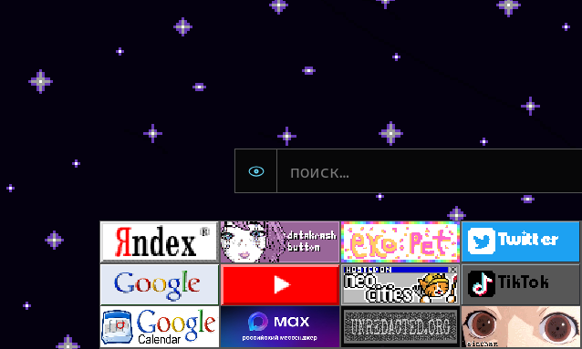

# golyb://home

Персональная стартовая страница с поиском и настраиваемыми кнопками-ссылками.

## Возможности

- Добавление, редактирование, удаление и перетаскивание кнопок; поддерживаются изображения и GIF.
- Настраиваемые поисковики, прямой переход по URL и история поиска.
- Выбор фонового цвета или изображения.
- Свой заголовок вкладки и шрифт интерфейса: установленный на компьютере или из Google Fonts.
- Экспорт и импорт настроек в JSON. В меню импорта также можно загрузить JSON из папки `import/` публичного GitHub-репозитория.

Настройки сохраняются в локальном хранилище браузера. Файлы конфигураций проекта находятся в `import/`.

В меню ⚙ → «настройки» можно задать заголовок вкладки и название шрифта. Для Google Fonts выбери соответствующий источник и введи название семейства (например, `JetBrains Mono`), без ссылки или CSS-кода. Загрузка из Google Fonts требует интернета; если шрифт недоступен, используется стандартный моноширинный. Подключение использует [официальный Google Fonts CSS API](https://developers.google.com/fonts/docs/css2). Пустые поля возвращают стандартный заголовок `golyb://home` и моноширинный шрифт. Эти настройки сохраняются в браузере и входят в экспорт JSON.
